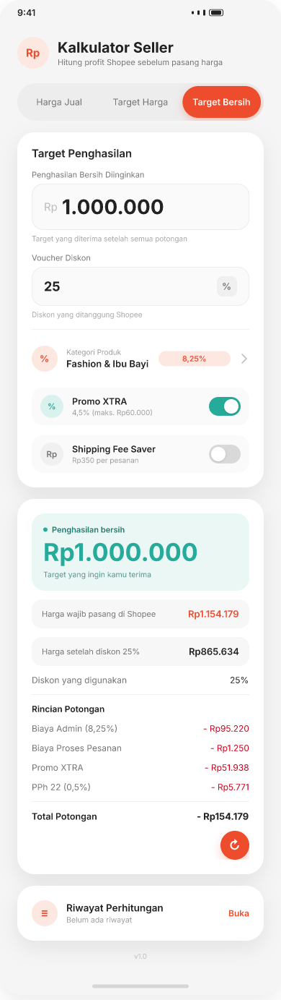

# 🧮 Market Calculator

**Calculate smarter. Sell with confidence.**

Market Calculator adalah aplikasi Android untuk membantu seller Shopee menghitung estimasi penghasilan bersih dari setiap transaksi secara transparan dan praktis.

Cukup masukkan harga produk atau target penghasilan, dan aplikasi akan menghitung potongan biaya secara otomatis — tanpa koneksi internet maupun akun tambahan.

<p align="center">
  
  
  
  
</p>

## ✨ Features

- **Selling Price** — Menghitung penghasilan bersih berdasarkan harga jual dan diskon.
- **Target Price** — Menentukan harga jual yang perlu dipasang berdasarkan target harga pembeli.
- **Target Net Income** — Menghitung harga sebelum dan sesudah diskon untuk mencapai target penghasilan bersih.
- **Automatic Fee Calculation** — Perhitungan biaya administrasi berdasarkan 9 tingkatan kategori produk.
- **Additional Fees** — Mendukung biaya proses pesanan, Promo XTRA, Shipping Fee Saver, dan PPh 22.
- **Transaction History** — Menyimpan hingga 50 riwayat perhitungan secara otomatis.
- **Light & Dark Mode** — Tampilan yang dapat disesuaikan dengan preferensi pengguna.
- **Offline & Privacy Friendly** — Dapat digunakan tanpa internet, akun, maupun permission tambahan.

## 🛠️ Tech Stack

| Technology | Usage |
|---|---|
| Kotlin | Main programming language |
| Jetpack Compose | Modern UI development |
| Material 3 | UI components and design |
| ViewModel & StateFlow | State management |
| DataStore | Local data persistence |
| kotlinx.serialization | Data serialization |
| Gradle Kotlin DSL | Build configuration |

## 🚀 Getting Started

### Prerequisites

- JDK 21
- Android SDK 36
- Android Studio

### Installation

Clone repository:

```bash
git clone https://github.com/Punyaadapaa/market_calculator.git
```

Navigate to project directory:

```bash
cd market_calculator
```

Build the application:

```bash
./gradlew assembleDebug
```

Untuk Windows, gunakan:

```bash
gradlew.bat assembleDebug
```

## 📌 Calculation Accuracy

Rumus perhitungan telah diverifikasi menggunakan data **Income Details** dari Shopee dengan selisih hasil Rp0 pada pengujian yang dilakukan.

## 📱 Project Status

**Current Version:** `v1.1`

Market Calculator masih dalam tahap pengembangan dan belum tersedia di Google Play Store.

## 👨‍💻 Developer

Developed by **Punyaadapaa**

---

<p align="center">
  <b>Market Calculator</b><br>
  Calculate smarter. Sell with confidence.
</p>
